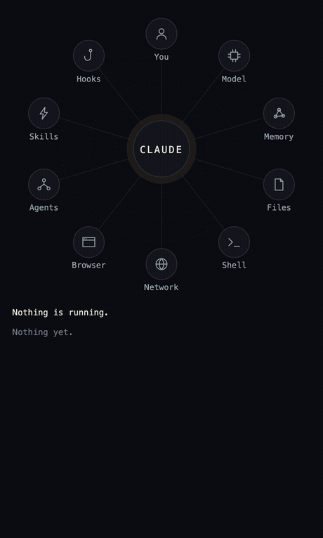
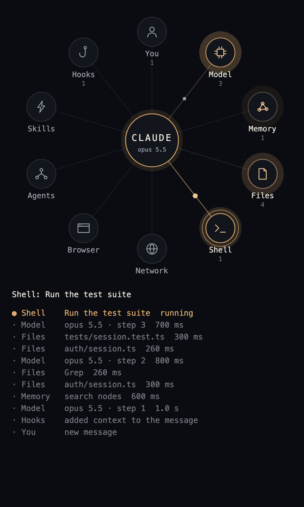
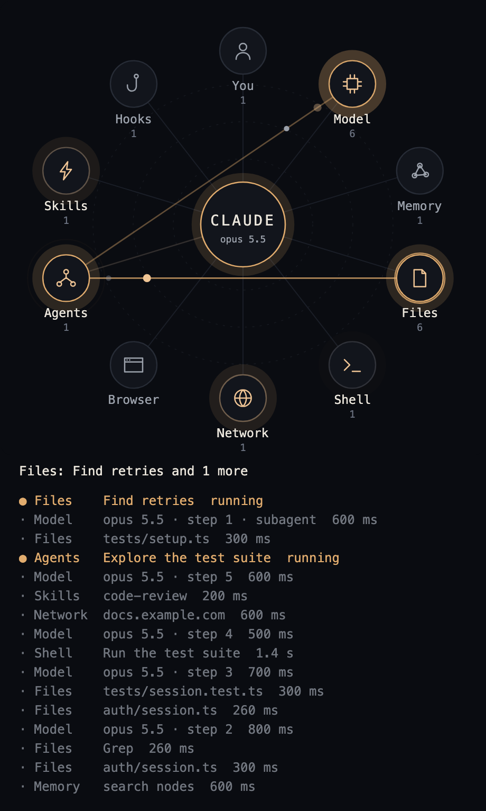
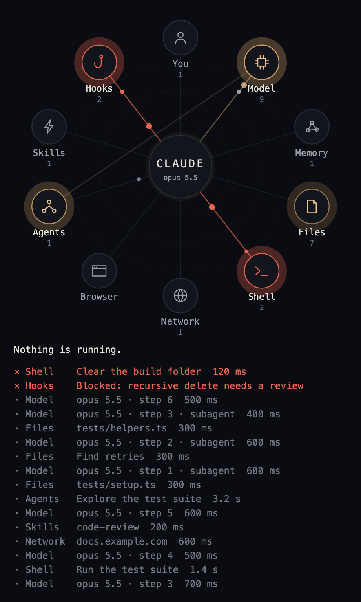
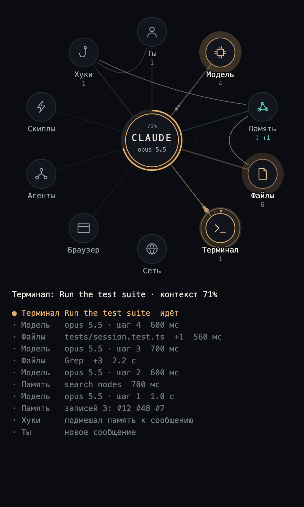

# lot-map

A mod for Claude Code: a live map of the work, in a pane beside the chat. Every tool call, model step, hook and skill sends a pulse from the centre to its station, so you see memory, files, shell, web and agents at work instead of reading a list of commands.



*A made-up session replayed through the mod's own drawing code. [Video (MP4)](docs/demo.mp4).*

## Install

At the prompt of a terminal session:

```
/plugin install lot-map --marketplace alexeyw/lot-map
```

Answer `y` to add the marketplace, then choose a scope. From a shell:

```bash
claude plugin install lot-map --marketplace alexeyw/lot-map
```

In the desktop app: click **+** next to the prompt box, then **Plugins**, **Add marketplace** with `alexeyw/lot-map`, then **Add plugin**.

The pane opens by itself when a session starts. In a terminal it needs at least 144 columns and draws text only; otherwise type `/lot-map`. Built and tested on Claude Code 2.1.317 on macOS.

## What lights up

| Station | When |
| --- | --- |
| You | your messages, questions and files sent to you |
| Model | each model request, context compaction |
| Memory | Claude Code's memory folder, plus whatever you name in the options |
| Files | Read, Write, Edit, Grep, Glob, and shell commands that only look at or move files |
| Shell | every other shell command |
| Network | web fetch and search, `curl`, `gh`, `git push` and the like, MCP servers |
| Browser | browser tools |
| Agents | subagents and workflows; their own calls start from this station |
| Skills | skills and tool search |
| Hooks | settings hooks that refuse a call, ask for permission, add context or take a moment |

A pulse flies out when something starts and returns when it ends. Refusals and errors turn red. Below the map are the current action and the last 16 rows: `●` running, `·` done, `✕` failed or blocked.

| At work | Subagents | A hook refuses |
| --- | --- | --- |
|  |  |  |

## Options

The install offers them on a screen. Later, use `/config` in a terminal or `claude plugin configure`, then restart the session.

| Option | Default | Meaning |
| --- | --- | --- |
| `language` | `en` | `en`, `ru`, `es`, `fr` or `de` |
| `coreName` | `CLAUDE` | what the circle in the middle says, up to ten characters |
| `memoryServers` | `memory` | MCP servers whose tools light Memory |
| `memoryCommands` | none | shell commands or scripts that light Memory, matched by how the name starts |
| `memoryPaths` | none | parts of a path that make a file a memory |
| `memoryLabels` | none | short names for memory tools, each as `tool=name` |
| `hookRecords` | `false` | turn on if a hook of yours adds memory records numbered like `[#123]`; they appear on Memory by number only |

For example, Russian labels and your own memory server:

```bash
echo '{"language":"ru","memoryServers":"my-memory"}' | claude plugin configure lot-map@lot-map --values-stdin
```

Lists are written with commas.



## What it shows and what it keeps

The mod makes no network requests, reads no files, runs no processes, calls no model and adds nothing to the conversation. Its rows live only for the session.

A label holds a name, never content:

- a file: the last two parts of its path;
- a web address: the host alone, without a login, path or query;
- a shell command: the short description Claude wrote for it, or the command's name, never the command line;
- a memory call: the tool's name and a record number, never the text or the query;
- a subagent: the short description it was started with;
- a hook's refusal: its first line, up to 72 characters.

A fault on the map never reaches a tool call or a model turn.

## Developing

```bash
claude plugin test .
claude plugin validate .
```

Words live in `hooks/text.ts`; a new language is one more table there and one more value of `language` in `.claude-plugin/plugin.json`.

## License

[MIT](LICENSE)
