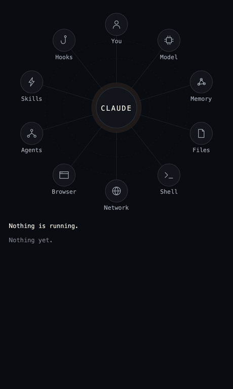
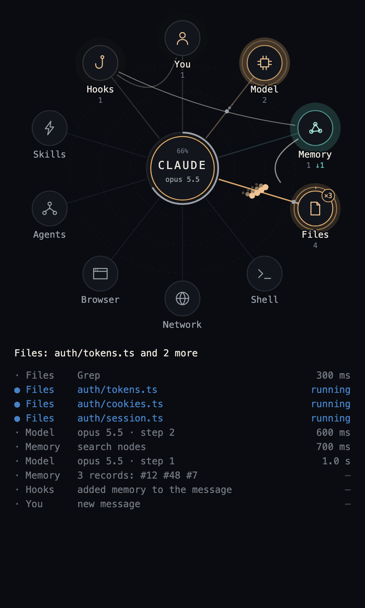
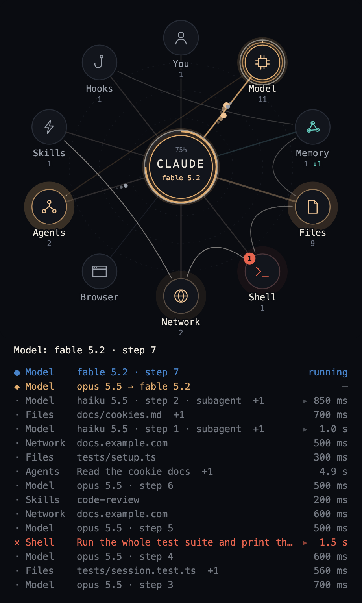
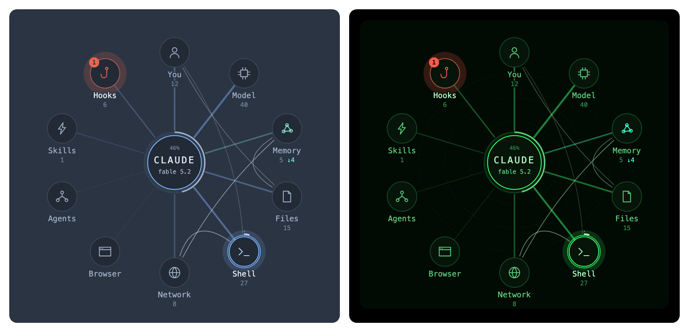

# lot-map

A mod for Claude Code: a live map of the work, in a pane beside the chat. Every tool call, model step, hook and skill sends a pulse from the centre to its station, so you see memory, files, shell, web and agents at work instead of reading a list of commands.

It runs on your machine and sends nothing anywhere. Local does not mean blind: like any mod that follows tool calls it is handed each call whole, and it takes names from that and nothing else. [What it reads and keeps](PRIVACY.md), and [the checks that hold it to that](PRINCIPLES.md).



*A made-up session replayed through the mod's own drawing code. [Video (MP4)](docs/demo.mp4).*

## Install

At the prompt of a terminal session:

```
/plugin install lot-map --marketplace alexeyw/lot-map
```

Answer `y` to add the marketplace, then choose a scope. From a shell:

```bash
claude plugin install lot-map --marketplace alexeyw/lot-map
```

If it answers that the plugin is not found in any marketplace, add the marketplace first:

```bash
claude plugin marketplace add alexeyw/lot-map
claude plugin install lot-map@lot-map
```

In the desktop app: click **+** next to the prompt box, then **Plugins**, **Add marketplace** with `alexeyw/lot-map`, then **Add plugin**.

The pane opens by itself when a session starts. In a terminal it needs at least 144 columns, otherwise type `/lot-map`, and it draws text only unless you ask for the map, as a picture or in braille dots: see [In a terminal](#in-a-terminal). Built and tested on Claude Code 2.1.321 on macOS; users report it working on Windows as well.

## Updating

From a shell:

```bash
claude plugin marketplace update lot-map
claude plugin update lot-map@lot-map
```

Then start a new session. The first command is needed: without it the second one reports the installed version as the latest.

What each version changed is in [CHANGELOG.md](CHANGELOG.md).

## What lights up

| Station | When |
| --- | --- |
| You | your messages, questions and files sent to you, the task list, the plan, and what you are asked to approve |
| Model | each model request, context compaction |
| Memory | Claude Code's memory folder, plus whatever you name in the options |
| Files | Read, Write, Edit, Grep, Glob, a language server's code intelligence, and shell commands that work on files and nothing else: they read, search, move, delete or edit in place (`cat`, `grep`, `mv`, `rm`, `sed`, `tee`, `find … -delete`) |
| Shell | every other shell command |
| Network | web fetch and search, MCP servers, work kept on claude.ai (artifacts, projects, designs), and shell commands known to reach the network: `curl`, `gh`, `ssh`, `rsync`, `git push`, `npm install`, `docker pull` and the like, also inside `$(…)` |
| Browser | browser tools |
| Agents | subagents, workflows, schedules, and waiting on background work; their own calls start from this station |
| Skills | skills, tool search, and the skill, plugin and connector catalogue |
| Hooks | settings hooks that refuse a call, ask for permission, add context or take a moment |

On Windows the PowerShell tool is read the same way as Bash, with PowerShell's own names: `Get-Content` and `Select-String` light Files, `Invoke-WebRequest` lights Network. A program run by its full path is read by its name, also from a quoted path with a space, and `CURL.EXE` is `curl`.

The shell stations go by the command's name, not by what it does: a script that opens a connection itself, such as `python -c "…"`, shows as Shell. A command behind `sudo`, `env`, `timeout`, `nohup`, `xargs` and the like is read as the command it runs, and `find … -exec` as the command it is told to run. So is a command inside a loop or a condition (`for … do`, `if … then`, `while`, `!`, `{ … }`), and a line handed to a shell or to `eval` (`bash -c "…"`). The text of a here-document is not read, so a file written through one shows as Files whatever the text says. A line is read up to its first 8,000 characters. `npx` counts as Network only with `-y`, since without it it mostly runs what is installed already.

A pulse flies out when something starts and returns when it ends. Refusals and errors turn red.

## Reading the map

- **The route.** A thin line joins the last few stations the main loop went through, in order, and its newest leg draws itself. A leg stays for 40 seconds and then fades over 20, so a minute after the work stops only the spokes are left; their thickness keeps where the work went. Model steps are left out, or every leg would pass through Model.
- **Worn spokes.** A spoke grows thicker and brighter the more its station is used, so at the end of a session the map shows where the work went.
- **How long.** Two clock hands grow around a station while a call runs: the inner one goes round in a minute, the outer one in ten.
- **Background work.** A command sent to the background, a monitor, a background subagent or a workflow stays lit on its station after the turn that started it is over, with the clock hands growing, until the task reports that it ended. A task that failed leaves the red dot. The report itself is not shown as a message of yours.
- **Several at once.** Calls that start together fly side by side, and the station carries their number, such as `×3`.
- **What went wrong.** A red dot with a count stays on a station from an error or a refusal until your next message.
- **Memory.** It has a colour of its own. A solid pulse is a memory Claude asked for; a hollow one on a dashed line is what a hook brought unasked. Under the station, the plain number counts the first and `↓` the second.
- **The context window.** The ring around the centre fills as the session goes, with the percentage above the name. It turns amber at 70% and red at 90%.
- **A change of model.** The centre and the Model station ring for a few seconds, and the feed gets a row such as `opus 5.5 → fable 5.2`. This also happens when a session starts on a different model from the last session in the same folder.
- **Subagents.** Each one still at work circles the Agents station as a small dot, and its calls start from there.
- **The answer.** One wide ring leaves the centre when the answer is ready.

Below the map are a line that says what runs now, and the last 16 rows: `●` running, `·` done, `✕` failed or blocked, `◆` a change of model. Finished calls that follow one another at one station fold into one row, marked `+2` for the two it stands for besides the one named. A call still running is never pushed out of the list by what came after it: it stays as the last row until it ends, so the list and the map say the same. Such rows take half the list at most; with more still running than that, the last one is marked `+22` for the rest.

Each row is one line. Its words are cut at the pane's edge; its time stands in a column at the right, with a dash for what took none, such as a message arriving, and on the answer's row the length of the whole turn. A row with a long label has a `▸` before its time: press it to read the row whole, and again to close it. One row is open at a time. In a terminal the line of now also holds the context percentage and the model at its right, since no drawing is there to show them.

### What each call adds to the context

The ring says how full the context window is, not what filled it. With `contextCost` on, a call's row says about how many tokens the context grew by with its answer, after its time: `85 ms +42k`. On the desktop map each station's count line adds the sum for the session: `9 · 180k`. The figure takes the colour of what stands beside it, the time on the row and the count on the map, so it reads wherever they do, on a light theme and on a dark one.

It is an estimate. Claude Code tells a mod how many tokens the last response was answered over, so the mod sees how much the context grew from one model step to the next, and puts that on the calls whose answers went with the step. The growth also holds the model's own words, what hooks added and, at the start of a turn, your message.

- **One step late.** A call's figure shows when the next step has been answered, not when the call ends. A call made in the last step of a turn, before an interrupted turn or before a compaction never gets one, and a compaction, which makes the context smaller, puts nothing anywhere.
- **Shared.** Two or three calls in one step share its growth evenly, and their figures are marked `~`: `~+14k`. With more calls in one step their rows get none, since an even share would give a large read and a short command the same figure; when all of them were at one station, that station's sum still gets the whole of it. A folded row adds up its calls' figures, marked `~` when some of them have none.
- **The main loop only.** A subagent fills a context of its own, which Claude Code does not report: its calls get no figure. The growth its answer brought shows on the main loop's call that started it.

For now the sums are on the desktop map only: VS Code's map, the terminal picture and the braille map show the rows' figures and not the sums.

| At work | Subagents | A hook refuses |
| --- | --- | --- |
|  |  |  |

| A change of model | After the answer | Light colours |
| --- | --- | --- |
|  |  |  |

## In a terminal

A terminal shows the rows alone. With `terminalView` set to `picture`, a terminal that shows pictures, such as kitty or Ghostty, gets the map as a picture above the rows, moving as it does in the desktop app. Claude Code must draw in fullscreen. If the pane stands under the conversation and not beside it, Claude Code is drawing on the main screen, and the rows stay alone: type `/tui fullscreen`, or start it as `CLAUDE_CODE_NO_FLICKER=1 claude`. Inside tmux, set `allow-passthrough on` and `focus-events on`. Any other terminal shows the rows alone, as before, and so does a pane narrower than 24 columns.

In iTerm2 the picture is off, and a line above the rows says so. iTerm2 keeps every picture it is sent until its tab is closed: in iTerm2 3.7.7 a moving map took about 2 MB a frame, 17 GB in five minutes (#81). The mod knows iTerm2 by `TERM_PROGRAM`, and by `LC_TERMINAL` over ssh or inside tmux. For the map there, set `terminalView` to `braille`.

The mod paints the picture itself, from the same drawing as the desktop app's, with letters from the X.Org misc-fixed bitmap fonts, which are in the public domain; [FONTS.md](FONTS.md) says where they come from. It paints up to thirty frames a second while anything on the map moves. The core breathes in the picture only while something runs, smoothly for ten minutes after the map last changed and then a frame every five seconds; at rest the picture stands still once the trails have faded.

With `theme` on `auto` the picture is light or dark by the terminal's `COLORFGBG`, which iTerm2, rxvt and Konsole set; where nothing says, it is dark, and on a light terminal that does not say, set `theme` to `light`. The picture has no background of its own, so the terminal's shows through it; where that is a shade off the pane's grey, it leaves a faint box around the map. `paneBackground` set to `transparent` takes the grey away, so the terminal shows behind the map and the rows alike, also where the terminal is see-through; set to the terminal's colour as `#rrggbb`, it paints the pane in it. `colors` with `background=#rrggbb` gives the picture a background of its own instead.

Nor does a terminal say how tall its cells are. `cellShape` does: how many times taller a cell is than it is wide, 2.4 by default, as iTerm2 draws Monaco 12, and about 2 for Menlo in kitty. If the picture leaves an empty band below it, raise it; if the band is at its right, lower it.

### The map in braille dots

With `terminalView` set to `braille`, the map stands above the rows as cells of text: braille dots for the spokes, the stations and the centre, letters for the names. It needs no pictures, only a font that has braille, so it shows in Windows Terminal and in most Linux terminals, where `picture` shows nothing. It is never a fallback: a terminal that cannot show the picture keeps the rows alone until you choose `braille` yourself.


It is the same board, read the same way, with what a cell can carry:

- **Stations.** An empty ring has not been used yet, a ring with a dot has, and a full one is at work now and beats. A station that just finished stays bright for a few seconds. Red is an error or a refusal, and `!1` after the name counts them until your next message; `x3` is how many calls run there at once.
- **Spokes.** A spoke takes its station's colour with the first call and a second line with much use. It lights when a call starts; a pulse flies out along it, and back when the call ends. What a hook brought unasked flies in from its station.
- **The centre.** Its outline is the context window, filling clockwise from the top, amber at 70% and red at 90%, with the percentage over the name and the model under it. The model's name is bright for a few seconds after a change. One ring leaves the centre when the answer is ready.
- **Subagents.** Each one still at work circles the Agents station as a dot.

What it does not draw, since a cell holds one colour and a dot is all the detail there is:

- the route between the stations, and its fading trail;
- the clock hands around a station at work;
- the icons in the stations, the dashed contours and the breathing of the centre;
- the rings where a pulse lands and where the model changes;
- pulses side by side: calls that start together fly as one, and `x3` says how many;
- memory's second count, `↓`, of what a hook brought unasked: one number counts both;
- the fading of a glow: a station is bright, and then it is not.

Its colours are the map's own, as in the desktop app. `theme` and `colors` hold; under `auto` it is light or dark by `COLORFGBG`, as the picture is, and dark where nothing says, so on a light terminal that does not say, set `theme` to `light`. `background` means here what it means there:

- `solid`, the default: the cells stand on the palette's background and the words take its text colour, so the map reads in any pane. The pane's own ground comes from Claude Code's theme, which the map cannot ask for; where that and the terminal differ, such as a light terminal under the dark theme, it is a light map in a dark pane, as the picture is.
- `transparent`: the cells have no ground and the words take the terminal's own colour. Choose it where the terminal and Claude Code's theme agree: the map then sits in the pane with no box around it. Where they differ the words can hardly be read. With `paneBackground` on `transparent` as well, the map and the pane both show the terminal behind them.

`layout` turns the ring. With `motion` on `reduced` nothing flies, beats or circles: a call lights its station and its spoke, and the subagents stand beside theirs.

Like the picture, the map shows only where the pane stands beside the conversation. Under Claude Code's default renderer the pane stands under the conversation and is too short for the map, so the rows stay alone: type `/tui fullscreen`, or start it as `CLAUDE_CODE_NO_FLICKER=1 claude`. The map needs a pane body of at least 50 columns and 25 rows, and takes up to 76 by 21; in a smaller pane the rows stay alone. It is painted again only when it will look different: about eight times a second while a pulse flies or a subagent circles, at each beat of a station at work, and not at all at rest. Ten minutes after the map last changed, what still runs gets a frame every five seconds.

## In VS Code

In the VS Code extension the pane is short, and the map drawn as wide as the pane does not fit it. There, and only there, three buttons stand at the end of the line of now. **Zoom out** and **Zoom in** draw the map at one of six widths, from 160 to 400 pixels, or as wide as the pane. **Hide map** folds the pane to that one line, and **Show map** brings the map back. What you chose is kept for the next session.

## Options

The install offers them on a screen. Later, use `/config` in a terminal or `claude plugin configure`, then restart the session.

| Option | Default | Meaning |
| --- | --- | --- |
| `language` | `en` | `en`, `ru`, `es`, `fr`, `de`, `it` or `pt` |
| `coreName` | `CLAUDE` | what the circle in the middle says, up to ten characters |
| `memoryServers` | `memory` | MCP servers whose tools light Memory |
| `memoryCommands` | none | shell commands or scripts that light Memory; a name counts when it is the command itself or begins with it and `-`, `_` or `.`, so `recall` also names `recall-sync.py` |
| `memorySubcommands` | none | words after a memory command that the map may show, such as `add` or `search`; without them the command goes by its own name |
| `memoryPaths` | none | parts of a path that make a file a memory |
| `memoryLabels` | none | short names for memory tools, each as `tool=name` |
| `serverStations` | none | put an MCP server's tools on a station of your choice, each as `server=station`, with `files`, `shell`, `web`, `browser`, `agents`, `skills` or `you`; the row still reads `server: tool`. What you set wins over the mod's own routes for the servers it knows. Memory keeps `memoryServers`, which wins if a server is in both; an unknown station is ignored |
| `hookRecords` | `false` | turn on if a hook of yours adds memory records numbered like `[#123]`; they appear on Memory by number only. Such a number in the text of any hook counts, not only a memory hook's |
| `hookReasons` | `false` | show the first line of a hook's refusal, up to 72 characters; off, the map says only which tool was stopped |
| `subagentNames` | `false` | a subagent's model step says which subagent it is, by the few words it was started with, up to 40 characters; off, it says only that it is a subagent |
| `contextCost` | `false` | each row says about how many tokens the context grew by with its call's answer, and the desktop map adds each station's sum to its count. An estimate, shown one step late; see [What each call adds to the context](#what-each-call-adds-to-the-context) |
| `theme` | `auto` | the map's colours: `dark`, `light`, or `auto`, which is dark on a dark surface and light on a light one |
| `background` | `solid` | the map's own background, or `transparent`, which lets the pane behind it show through. The rim around the labels keeps the background's colour, so on a surface of another shade it shows as a faint halo |
| `paneBackground` | `theme` | what the pane itself is painted with: `theme`, Claude Code's own; `transparent`, which lets the terminal or the app behind it show through, wallpaper and blur included; or a colour as `#rrggbb`, to match an opaque terminal. A surface that cannot do it keeps its own. See [In a terminal](#in-a-terminal) |
| `colors` | none | colours of your own, each as `name=#rrggbb`; see [Colours of your own](#colours-of-your-own) |
| `layout` | `you-top` | where you are on the map: `you-top`, or `you-bottom`, which turns the ring half a turn so that you are at the bottom and the network and the browser at the top |
| `motion` | `full` | `full`, or `reduced`: nothing flies, spreads or spins. A call still lights its station and flashes its spoke, the route still gets its leg, and those only fade; the clock hands around a running station stay, as slow as a clock's |
| `textSize` | `footnote` | the size of the rows under the map: `caption`, `footnote` or `body`. A terminal has one size and ignores it |
| `terminalView` | `text` | how the map looks in a terminal: `text`, the rows alone; `picture`, the map's picture above them in a terminal that shows pictures, but not in iTerm2; or `braille`, the map above them in braille dots, in any terminal whose font has braille. See [In a terminal](#in-a-terminal) |
| `cellShape` | `2.4` | for the terminal picture: how many times taller a terminal cell is than it is wide, from 1.2 to 4, so that the picture fills its box; see [In a terminal](#in-a-terminal) |

For example, Russian labels and your own memory server:

```bash
echo '{"language":"ru","memoryServers":"my-memory"}' | claude plugin configure lot-map@lot-map --values-stdin
```

Lists are written with commas.

| Russian labels | `layout` set to `you-bottom` |
| --- | --- |
|  |  |

## Colours of your own

`colors` replaces the map's colours one by one. Set one, a few, or all thirteen; what you leave out stays as it is.

```bash
echo '{"theme":"dark","colors":"accent=#7fb4ff,active=#b8d6ff,text=#e6edf7"}' | claude plugin configure lot-map@lot-map --values-stdin
```

| Name | What it colours |
| --- | --- |
| `background` | the map's ground, and the rim around the labels |
| `node` | the inside of a station and of the centre |
| `line`, `spoke` | the dashed contours and the idle spokes |
| `text`, `label`, `faint` | the name in the centre and lit labels, the other labels, the counts |
| `accent`, `active` | the main colour, and a station at work |
| `error` | errors and refusals |
| `memory`, `memoryActive` | the Memory station and its spoke |
| `route` | the route between stations |



- Only `#rgb` and `#rrggbb` are taken. Anything else, and any other name, counts as not set.
- With `theme` left on `auto`, a colour of your own holds on a light surface as well, and the rest is repainted as before. With a whole palette of your own, set `theme` to `dark` or `light`.
- With `background` set to `transparent`, still give `background` here the colour of your pane: the rim around the labels takes it, and the halo is gone.

## What it shows and what it keeps

The mod makes no network requests, reads no files, runs no processes, calls no model and adds nothing to the conversation. Its rows live only for the session. The same on one page: [Privacy](PRIVACY.md).

Like any mod that follows tool calls, it is handed every call's whole input, including command lines and the text written to files. It takes names from that and nothing else; the code that does so is `classify` in `hooks/classify.ts`. A marketplace added from this repository follows its `main` branch, so an update brings whatever is there: read the diff before updating if that matters to you.

It asks Claude Code for one thing: how full the context window is, after each model step. With `contextCost` on it also keeps, from the same answer, how many tokens that is, and puts a number on each row and station; it reads nothing more for it. Between sessions it keeps one thing, the name of the model last used in each folder, so that it can show a change. Each is stored under the folder's full path, in Claude Code's own store for the plugin.

What its hooks do. The mod listens to the session's start, prompts, turns, model steps, tool calls, skills, compaction, with `subagentNames` on a subagent's start, and to three events of settings hooks: `PreToolUse`, where it sees whether a hook refused the call, asked for permission or took a moment, and `UserPromptSubmit` and `SessionStart`, where it sees the context a hook added. Each of its hooks passes the event on as it came and returns what came back as it was: it changes no input, no result, no context and no permission decision, and makes none of its own. Its one command, `/lot-map`, opens the pane.

A label holds a name, never content:

- a file: the last two parts of its path;
- a web address: the host alone, without a login, password, path or query; an address that can be read two ways shows only its scheme;
- a shell command or a monitor: the short description Claude wrote for it, or the command's name, never the command line. The description is the model's own words, and the mod shows them as written;
- a search: the tool's name for `Grep` and `Glob`, the words `web search` for a web search and `loading tools` for a tool search, in the map's language, never the pattern or the query;
- a memory call: the tool's name and a record number or short identifier, never the text or the query;
- a memory command: its name, and the word after it only if you listed that word in `memorySubcommands`;
- a subagent: the short description it was started with; with `subagentNames` on, its first 40 characters on that subagent's model steps as well;
- a background task's report: that the task ended and whether it failed, never its summary or its output;
- a hook's refusal: the name of the tool it stopped. Its first line shows only with `hookReasons` on, because a refusal may quote what the hook found.

Control characters are taken out of every label before it is drawn.

A fault on the map never reaches a tool call or a model turn.

## Developing

```bash
claude plugin test .
claude plugin validate .
```

Words live in `hooks/text.ts`; a new language is one more table there and one more value of `language` in `.claude-plugin/plugin.json`.

The terminal picture is painted by `hooks/raster.ts`, which reads the drawing `drawMap` makes. A test paints every kind of drawing and fails on anything the painter does not know, so a change to the drawing that needs more of SVG shows there first. Another, `the terminal picture's font has every letter the map writes, in every language`, names the letters a new language needs added to `hooks/font.ts`; [FONTS.md](FONTS.md) says how to make that file again.

The braille map is drawn by `hooks/braille.ts`: a second drawing of the same board, which takes its stations from `STATIONS` and its timings from `hooks/draw.ts`. Tests in `hooks/braille.test.tsx` hold it to every station under both layouts, and one in `hooks/lot-map.test.tsx` to the names of every language. Something new on the map is either drawn there too or added to the list of what braille leaves out, in [In a terminal](#the-map-in-braille-dots).

Before you send a change, read [CONTRIBUTING.md](CONTRIBUTING.md). What the mod holds to, and the check behind each point, is in [PRINCIPLES.md](PRINCIPLES.md).

## License

[MIT](LICENSE)
