# How the options look

The options that change what you see, each with a picture of its values. What every option means, and how to set one, is in the README under [Options](../README.md#options).

The pictures of the map are painted by the mod's own code from one made-up session: `node scripts/option-pictures.mjs` makes them again. The pictures of a terminal are shots of a kitty window.

## The map

| Option | As it comes | Changed |
| --- | --- | --- |
| `theme` | `dark`  | `light` 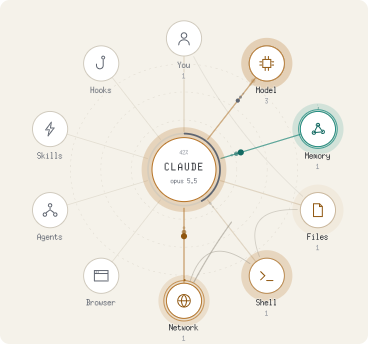 |
| `background` | `solid`  | `transparent`, here over a blue surface 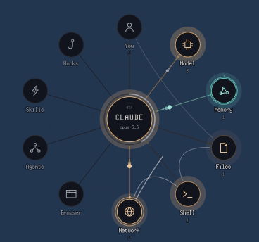 |
| `colors` | none  | `accent=#7fb4ff,active=#b8d6ff,text=#e6edf7` 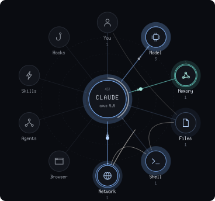 |
| `layout` | `you-top`  | `you-bottom` 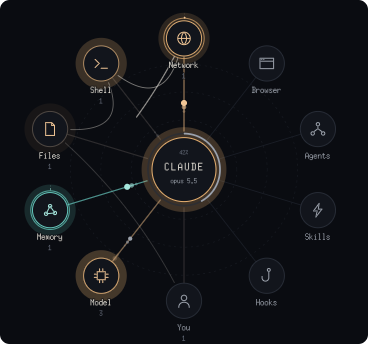 |
| `coreName` | `CLAUDE`  | `HOME`  |
| `language` | `en`  | `ru` 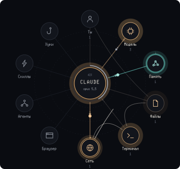 |

`theme` comes as `auto`: dark on a dark surface and light on a light one. `language` also takes `es`, `fr`, `de`, `it` and `pt`.

## Motion

| `motion: full` | `motion: reduced` |
| --- | --- |
| 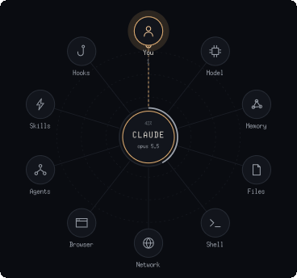 | 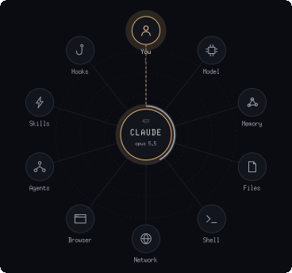 |

The same session twice. With `reduced` nothing flies, spreads or spins: a call still lights its station and its spoke, and those only fade.

## In a terminal

`terminalView` says what stands above the rows.

| `text` | `picture` | `braille` |
| --- | --- | --- |
| 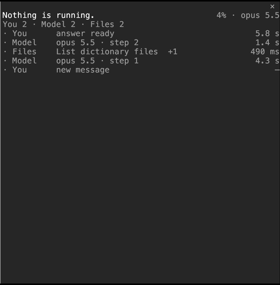 | 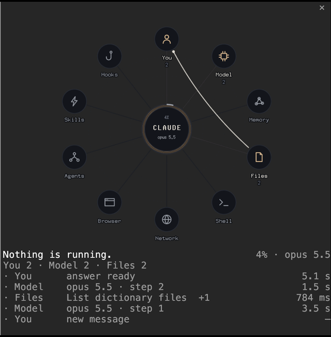 | 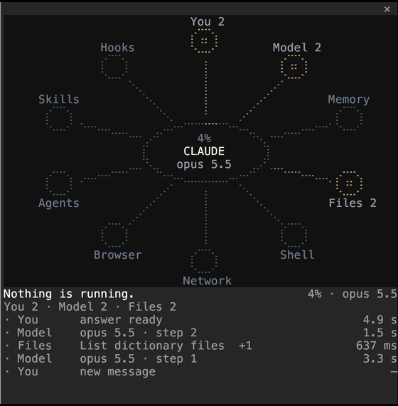 |

`paneBackground` says what the pane itself is painted with. The terminal in these shots is black.

| `theme` | `transparent` | `#16263d` |
| --- | --- | --- |
|  | 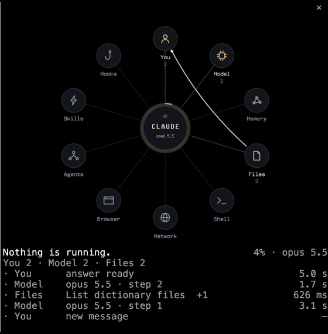 | 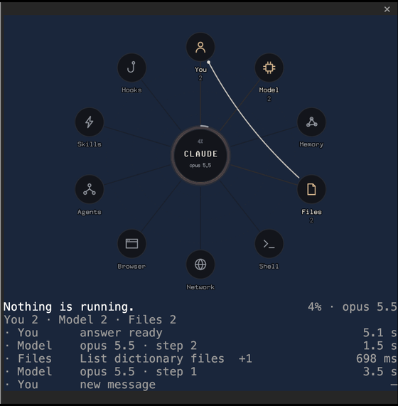 |

## Without a picture here

- `textSize` (`caption`, `footnote`, `body`): the size of the rows under the map in the desktop app. A terminal has one size.
- `logRows` (`16`, `fill`): how many rows the list shows in the desktop app's docked pane.
- `openAtStart` (`true`, `false`): whether the pane opens by itself when a session starts.
- `cellShape`: how tall a terminal's cells are, which sizes the picture's box.
